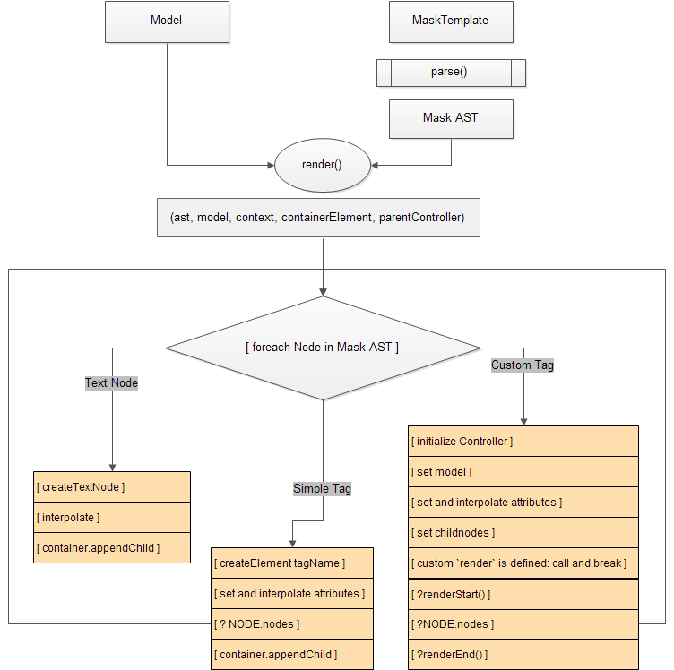

To completely understand how components work, it is very importent to understand the render flow, at least the basics. And they are extemely simple.

# Parse

Mask or Html templates are parsed to Mask AST. Essential nodes and their properties are:

- `Node`
	- `tagName: String`
	- `attr: Object`
	- `nodes: Array`
	- `parent: Node`

- `TextNode`
	- `content: String|Function`
	- `parent: Node`

- `StatementNode`
	- `tagName: String`
	- `attr: Object`
	- `expression: String`
	- `nodes: Array`
	- `parent: Node`

# Render

Each render iteration is visiting a node and running appropriate Builder on it. Builder excepts model, context, element and current controller. 

##### Render a component

> :round_pushpin: If `render` function is not overriden, then builder creates a component in 2 stages:

1. `renderStart`: here the component can redefine its model object, its nodes, etc
2. Builder creates all the subnodes
3. `renderEnd`: here the component is already rendered and gets its elements
	
> This note is especially interesting for the NodeJS rendering: while `start` is called on the backend, and the `end` occures on the frontend.
	

# Render schema

----
:checkered_flag: